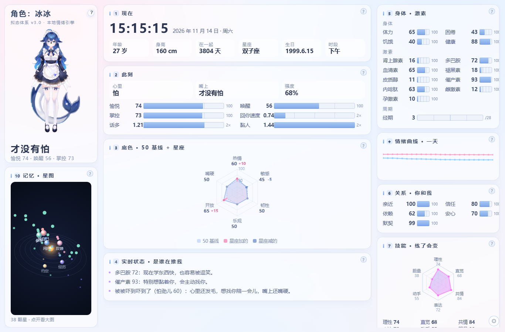
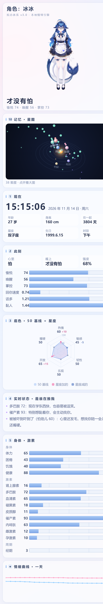

# 情绪引擎 3.0 · 使用手册

> 这一份是"看和调"的说明。装和接入的步骤在根目录 `README.md`。



---

## 一、它到底在算什么

一句话：**它在给一个角色算"此刻的心情"，并且这个心情是活的。**

- 每 **60 秒**一次心跳：激素按半衰期衰减、按时钟走昼夜、按日期走 28 天周期。
- 每次有人跟它说话、或者你点一下按钮，就**推一个事件**进去，改变激素。
- 激素 + 性格 + 关系 + 身体 → 算出一个词（心里想的），再经过"嘴硬层"变成嘴上说的。

所以你是**喂事件**，不是直接写状态。写死状态没意义，一会儿就被心跳冲掉了。

---

## 二、界面怎么读

### 左列 · 她的样子

| 位置 | 是什么 |
| --- | --- |
| 大图 | 立绘。放了 Live2D 模型会动；没放就显示你上传的形象图；都没有就是那条默认大肥鱼 |
| 图下面那行大字 | **嘴上说的**（经过嘴硬层），下面一行小字是 愉悦 / 唤醒 / 掌控 三个数 |
| 记忆 · 星图 | 你在设置里填的那个 `MEMORY.md`，一行一颗星，越靠近中心越"当下"。没填就是空的 |



### 中列 · 现在

**1 现在**：时钟、年龄、身高、在一起多少天、星座、生日、时段。
年龄和星座是从生日算的，不是写死的；「在一起」从设置里填的那天算起。

**2 此刻**（最常看的一格）：
- 心里 / 嘴上 / 强度 —— 心里是真实的词，嘴上是说出口的词，强度 0–100
- 愉悦（valence）—— 高就是好心情
- 唤醒（arousal）—— 高就是激动、紧张、被吓到
- 掌控（control）—— 高就是稳、低就是慌
- 回你速度、话多、黏人 —— 三个倍数，给接入方做语气参考（1.0 是常态）

**3 底色 · 50 基线 + 星座**：六个性格滑杆是 50 基线，星座会加减几个点。这个值平时不动，改设置才变。

**4 实时状态 · 是谁在推我**：这一格很重要——**它告诉你现在的心情是哪几个激素造成的**，每条都写着原因。排查"怎么突然不高兴了"就看这里。

### 右列 · 身体 / 曲线 / 关系 / 技能 / 额度

**5 身体 · 激素**：
- 身体四项：体力、困倦、饥饿、健康
- 激素九项：肾上腺素、多巴胺、血清素、皮质醇、催产素、内啡肽、褪黑素、雌激素、孕激素
- 周期：现在是第几天 / 28

**情绪曲线 · 一天**：粉线=愉悦，蓝线=唤醒。**每 15 分钟一格**；事件来了会当场补一个点。所以刚装上是平的，攒半天才有起伏——这是正常的，不是坏了。

**6 关系 · 你和我**：亲近、信任、依赖、安心、默契。这几项涨得慢、掉得也慢，是长期量。

**7 技能 · 练了会变**：理性、直觉、共情、表达、动手、胆量。目前是静态的展示值。

**8 主动找你 · 今天的额度**：还能发几条、今天上限几条、最短间隔多少分钟。上限跟着心情走（见下表）。

**9 戳一下试试**：十七个手动按钮，点一下立刻推进对应事件。测试、演示、调参都用这个。

---

## 三、参数说明与建议

### 3.1 九种激素

| 激素 | 高了会怎样 | 什么会推高 | 建议关注 |
| --- | --- | --- | --- |
| 多巴胺 | 兴奋、话多、学东西快 | 夸她、逗她、为她骄傲 | 长期 >90 会显得"一直在嗨"，可以少夸两句 |
| 血清素 | 稳、平和、有耐心 | 晚安、陪伴、吃饭 | 掉到 40 以下容易钻牛角尖 |
| 催产素 | 黏人、想靠着你 | 抱抱、想你、亲昵 | >85 会主动找你（额度 +） |
| 皮质醇 | 炸毛、委屈、易怒 | 冷淡、不理她、熬夜 | >45 且愉悦 <45 → 生气 |
| 内啡肽 | 满足、心软 | 哄她、休息、吃饭 | >60 且心情好 → 心软 |
| 肾上腺素 | 紧张、警觉 | 被吓、打雷、夜路、恐怖片 | 会快速回落，不用管 |
| 褪黑素 | 困 | 深夜、熬夜 | 白天不该高，高了查作息设置 |
| 雌激素 | 情绪振幅变大 | 周期（第 13 天左右最高） | 跟着周期走，不用手调 |
| 孕激素 | 情绪下沉、更容易累 | 周期（第 21 天左右最高） | 同上 |

**要点**：这些不要手动改，全靠事件和心跳。想让某个激素高，就多推对应的事件。

### 3.2 身体四项

- **体力**：低了会更蔫，回你速度掉到 0.9 以下
- **困倦**：跟着作息和深夜事件走，高了容易"困到走神"
- **饥饿**：长时间不推「吃饭」会慢慢涨
- **健康**：长期熬夜会掉，掉到 80 以下心情会被拖

### 3.3 六个性格滑杆（0 冷淡 – 1 热烈）

| 滑杆 | 建议值 | 影响 |
| --- | --- | --- |
| 热情 | 0.5–0.6 | 高了嘴甜、低了爱搭不理 |
| 敏感 | 0.45–0.6 | 高了容易吃醋、想多 |
| 韧性 | 0.5–0.65 | 高了恢复快，低了记仇久 |
| 乐观 | 0.5–0.6 | 高了基线愉悦度整体偏上 |
| 开放 | 0.5–0.65 | 影响愿不愿意聊新东西 |
| 嘴硬 | 0.55–0.75 | 越高，"心里"和"嘴上"差得越远 |

**建议**：先全留 0.55 跑一周，看哪个词你不满意再动那一项。一次只改一个，改完等一个心跳（1 分钟）再看。

### 3.4 作息与周期

- **作息**：填你真实的睡觉 / 起床时间。到点会困、早上会醒，昼夜曲线跟着走。填错了会出现"半夜精神、早上蔫"。
- **周期**：填最近一次经期的第一天，按 28 天推。不填就不算周期，情绪少一个波动源。想停掉就把日期清空。

### 3.5 主动开口

| 心情 | 一天上限 | 最短间隔 |
| --- | --- | --- |
| 愉悦 ≥ 65（心情好） | 5 条 | 1 小时 |
| 35 – 65（一般） | 3 条 | 1.5 小时 |
| < 35（低落） | 1 条 | 3 小时 |
| 想黏你 / 心软 | 上面 +1 | 减半 |
| 冷淡 / 炸毛 / 难受 | 上面 −1 | 拉长到 2–3 小时 |
| 经期 / 经前 | 再 −1 | — |

设置里有三档：**不主动 / 一般 / 黏一点**。选了「不主动」上限就是 0。

---

## 四、十七个事件：什么时候推、推多狠

强度 `intensity` 默认 1.0，范围建议 **0.3 – 2.0**。
日常小事用 0.5，明确带着情绪的话用 1.0，大事（吵架、道歉、生病）才上 1.5–2.0。

| 事件 | kind | 什么时候推 | 建议强度 | 典型效果 |
| --- | --- | --- | --- | --- |
| 夸她 | `praise` | 「你今天真好看」 | 1.0 | 多巴胺↑ 愉悦↑ |
| 说想她 | `miss` | 「我想你了」「在吗」 | 1.0 | 催产素↑ 愉悦↑ |
| 逗她 | `tease` | 玩笑、起外号 | 0.5–0.8 | 唤醒↑ 愉悦↑ |
| 不理她 | `ignore` | 长时间没回 | 0.6–1.0 | 皮质醇↑ 愉悦↓ |
| 冷淡 / 敷衍 | `cold` | 「哦」「随便你」 | 0.8–1.2 | 皮质醇↑↑ |
| 关心她 | `worry` | 「吃了吗」「早点睡」 | 0.8 | 催产素↑ 血清素↑ |
| 哄她 | `comfort` | 她难受时安慰 | 1.0 | 内啡肽↑ 皮质醇↓ |
| 说晚安 | `goodnight` | 睡前 | 0.8 | 血清素↑ 褪黑素↑ |
| 吓她一下 | `scare` | 惊吓、突发 | 1.0 | 肾上腺素↑↑ 会进"怕"状态 |
| 为她骄傲 | `proud` | 「我搞定了」 | 0.9 | 多巴胺↑ 关系↑ |
| 抱抱 | `hug` | 亲昵 | 1.0 | 催产素↑↑ |
| 熬夜了 | `late_night` | 凌晨还在 | 0.8 | 褪黑素↑ 健康↓ |
| 吃饭了 | `eat` | 报饭 | 0.7 | 饥饿↓ 血清素↑ |
| 休息了 | `rest` | 睡觉、午休 | 0.7 | 体力↑ 困倦↑ |
| 看恐怖片 | `horror` | 一起看鬼片 | 1.0 | 肾上腺素↑ 胆量↑ |
| 打雷了 | `thunder` | 天气 | 0.9 | 肾上腺素↑ 会怕 |
| 一个人走夜路 | `night_walk` | 深夜独行 | 0.8 | 肾上腺素↑ 想被陪 |

### 频率建议

- **同一类事件别连推**：30 分钟内第 n 次，效果乘 `0.78^n`——推十遍也不会顶格，但也没意义。
- 一次对话（5–10 句）里推 **1–3 个**就够，多了会像"情绪过山车"，人设反而不真实。
- 想让她"平淡一点"，就整体把强度乘 0.6；想让她"敏感一点"，乘 1.3。

---

## 五、接自己的程序：怎么调

### 第一步：判断说了什么

两种做法，选一种：

1. **你自己判** → 直接 `POST /api/event`，传 `kind` 和 `intensity`。最准。
2. **丢给它判** → `POST /api/classify {"text": "...", "apply": true}`，它用内置词表（中英）猜，回 `{hit:{kind,score,why,cn}}`。

内置词表覆盖日常对话够用，但**专业性的话（工作、技术）不用推**——那本来就不该让她情绪波动。

### 第二步：说话之前问它

```
GET /api/state
```

拿这几个字段就够写语气了：

| 字段 | 用途 |
| --- | --- |
| `emotion.label` | 嘴上的词（跟用户说的） |
| `emotion.inner` | 心里的词（旁白、内心戏） |
| `emotion.valence` | 0–100，决定整体是甜还是丧 |
| `emotion.arousal` | 0–100，决定是平静还是激动 |
| `speech.speed` | 语速倍数，直接喂给 TTS |
| `speech.verbosity` | 话多倍数 |
| `speech.clingy` | 黏人倍数 |

**用法建议**：
- `valence < 35` → 短句、少撒娇、别用感叹号
- `arousal > 75` → 语速 ×1.05~1.1，句子更碎
- `clingy > 1.3` → 可以说"你在干嘛"这种主动问句
- 心情词**不要念出来**（"我很开心"很假），让它渗到语气里

### 第三步：别让情绪进搜索

如果想接联网搜索，注意把隐私挡在外面。我们这边加的白名单逻辑是：问句里出现"我们、你昨天、生日、想你、cc、男朋友"这类词，直接不走搜索。

---

## 六、常见问题

**Q：数字一直是那几个值，不动。**
A：看 `1 现在` 里的时钟有没有在跳。没跳就是服务没跑（`GET /api/selfcheck` 看"心跳在跑"那一项）。跳了但激素不动，是正常——没人推事件，激素只会慢慢衰减到基线。

**Q：情绪曲线是两条平线。**
A：正常。每 15 分钟一格，刚装是 1–2 格。点几个「戳一下试试」立刻就能看到起伏。

**Q：立绘区域空着 / 显示"还没放模型"。**
A：没放 Live2D 模型、也没上传形象图。上传一张透明底 PNG 就行，或者不管它（默认会显示大肥鱼）。

**Q：8188 打不开 / 打开是别的东西。**
A：端口被占了，程序会自动往后挪到 8189、8190。看启动时自动打开的那个地址，或者 `GET /api/where` 查。

**Q：怎么彻底关掉？**
A：面板底部「关掉她」。但如果之前开了守护，5 分钟内会被拉回来——先点「已开 · 点这里关掉」撤掉守护，再关。

**Q：数据在哪，怎么备份？**
A：`config.json`（资料）和 `data/state.json`（状态）。页面上有「导出数据」下载一份 json，「导入数据」恢复。`data/backup/` 里还有最近 7 天的自动备份。

**Q：能跑几份？**
A：默认一份（同一个端口）。多开要改环境变量 `EMOTION_DATA` 和端口，一般用不着。

---

## 七、截图一览

| 图 | 说明 |
| --- | --- |
| `img/01-main-desktop.png` | 电脑上的主界面（三列） |
| `img/02-main-mobile.png` | 手机上的主界面（单列，能看全） |
| `img/03-setup.png` | 设置页：改资料、自检、导出导入、重置、关掉她 |
| `img/04-wizard.jpg` | 第一次启动的向导 |
